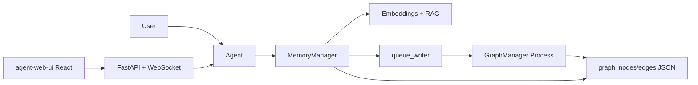

<!-- Generated by SpecStory, Markdown v2.1.0 -->

# 2026-07-05 15:24:01Z

<!-- Cursor IDE Session f78a456c-7943-4a1b-b855-9901adbe45a5 (2026-07-05 15:24:01Z) -->

_**User**_

It has been a while since I worked on this project. Please review an dget up tp speed so we can continut.

---

_**Agent (default)**_

<think><details><summary>Thought Process</summary>
I am reviewing the project to get up to speed.
</details></think>

_**Agent (default)**_

Reviewing the project state: recent changes, docs, and current architecture.


_**Agent (default)**_

<tool-use data-tool-type="read" data-tool-name="read_file_v2"><details>
<summary>Tool use: **read_file_v2** • Read file: /Users/andrewrapo/github/cursor/cursor-hello-llm-agent/README.md</summary>

</details></tool-use>

_**Agent (default)**_

<tool-use data-tool-type="shell" data-tool-name="run_terminal_command_v2"><details>
<summary>Tool use: **run_terminal_command_v2** • Run command: cd /Users/andrewrapo/github/cursor/cursor-hello-llm-agent &amp;&amp; git log --oneline -15 &amp;&amp; echo &#34;---&#34; &amp;&amp; git branch -a &amp;&amp; echo &#34;---&#34; &amp;&amp; git status -sb</summary>
```bash
cd /Users/andrewrapo/github/cursor/cursor-hello-llm-agent && git log --oneline -15 && echo "---" && git branch -a && echo "---" && git status -sb
```

```
7234294 docs: Updated docs and added a Getting Started article
19280ce docs: update REEADME.md
1966621 docs: update README.md
6b838f0 Merge pull request #7 from wwlib/feature/phase-6-optimization
f97647c docs: updated docs
3f4fb8e feat: Final Phase 6 cleanup, tests and docs
cc33094 docs: specstory documentation update
3058a3a feat: specstory documentation update
5968e68 feat: graph processing working but not optimally
3b9bb08 cleanup: deleted old test results
a21536a feat: progress commit - but lots of issues and cleanup needed
efff132 feat: in progress - working on background graph processing
e3f0888 docs: added successful output example: test_non_blocking_graph_processing-successful-output.md
0e75d83 feat: minor update - snapshot of working system - still need to get bg processing working right
e1c743f feat: graph architecture optimization
---
  feature/phase-6-optimization-bg-processing
* main
  remotes/origin/HEAD -> origin/main
  remotes/origin/main
---
## main...origin/main
 M .specstory/.what-is-this.md
 M .specstory/history/2025-04-02_16-58Z-project-update-and-feature-summary.md
 M .specstory/history/2025-04-02_16-58Z-python-package-installation-error-troubleshooting.md
 M .specstory/history/2025-04-03_02-12Z-python-package-installation-error-troubleshooting.md
 M .specstory/history/2025-04-05_13-24Z-testing-llm-connection-with-python.md
 M .specstory/history/2025-04-05_19-37Z-memory-manager-vs-simple-memory-manager-analysis.md
 M .specstory/history/2025-04-10_16-31Z-project-codebase-overview.md
 M .specstory/history/2025-04-13_18-21Z-code-review-for-memorymanager-project.md
 M .specstory/history/2025-04-14_01-50Z-project-code-review-and-description.md
 M .specstory/history/2025-04-16_03-23Z-code-review-memorymanager-and-digestgenerator.md
 M .specstory/history/2025-04-16_16-17Z-branching-strategy-for-experimental-changes.md
 M .specstory/history/2025-04-18_21-21Z-project-analysis-and-improvement-suggestions.md
 M .specstory/history/2025-04-29_22-20Z-evaluat
… (output truncated)
```
</details></tool-use>

_**Agent (default)**_

<tool-use data-tool-type="read" data-tool-name="read_file_v2"><details>
<summary>Tool use: **read_file_v2** • Read file: /Users/andrewrapo/github/cursor/cursor-hello-llm-agent/src/memory/simple_memory_manager.py</summary>

</details></tool-use>

_**Agent (default)**_

<tool-use data-tool-type="search" data-tool-name="glob_file_search"><details>
<summary>Tool use: **glob_file_search** • Searched codebase "" • **1** result in **1** directory</summary>

Directory: **``** (1 file)

| File |
|------|
| `launcher.py` |
</details></tool-use>

_**Agent (default)**_

<think><details><summary>Thought Process</summary>
Reviewing Phase 6 documentation and the current plan to get back up to speed.
</details></think>

_**Agent (default)**_

<tool-use data-tool-type="read" data-tool-name="read_file_v2"><details>
<summary>Tool use: **read_file_v2** • Read file: /Users/andrewrapo/github/cursor/cursor-hello-llm-agent/docs/phase-6/README-phase-6.md</summary>

</details></tool-use>

_**Agent (default)**_

<tool-use data-tool-type="shell" data-tool-name="run_terminal_command_v2"><details>
<summary>Tool use: **run_terminal_command_v2** • Run command: cd /Users/andrewrapo/github/cursor/cursor-hello-llm-agent &amp;&amp; git diff --stat &amp;&amp; echo &#34;=== simple_memory_manager ===&#34; &amp;&amp; git diff src/memory/simple_memory_manager.py | head -80</summary>
```bash
cd /Users/andrewrapo/github/cursor/cursor-hello-llm-agent && git diff --stat && echo "=== simple_memory_manager ===" && git diff src/memory/simple_memory_manager.py | head -80
```

```
 .specstory/.what-is-this.md                        |    2 +-
 ...02_16-58Z-project-update-and-feature-summary.md | 6694 ++++++++++----------
 ...n-package-installation-error-troubleshooting.md |    8 +-
 ...n-package-installation-error-troubleshooting.md |    2 +-
 ...05_13-24Z-testing-llm-connection-with-python.md |  276 +-
 ...ry-manager-vs-simple-memory-manager-analysis.md |  158 +-
 .../2025-04-10_16-31Z-project-codebase-overview.md |  572 +-
 ...18-21Z-code-review-for-memorymanager-project.md | 1964 +++---
 ...4_01-50Z-project-code-review-and-description.md | 1848 +++---
 ...ode-review-memorymanager-and-digestgenerator.md |  882 +--
 ...-branching-strategy-for-experimental-changes.md |    6 +-
 ...project-analysis-and-improvement-suggestions.md |  560 +-
 ...Z-evaluating-digest-generation-effectiveness.md | 1054 +--
 ..._16-42Z-refactoring-memory-compression-class.md | 1156 ++--
 ...02-09Z-unicode-to-ascii-conversion-in-python.md |   86 +-
 ..._15-24Z-code-review-and-todo-item-discussion.md |  290 +-
 ...19-17Z-phase-2-project-code-review-and-todos.md |  908 +--
 ...-04_14-00Z-update-readme-with-latest-changes.md | 2160 +++----
 ...-33Z-code-review-and-cleanup-plan-discussion.md | 3344 +++++-----
 ...Z-code-review-and-data-preprocessor-creation.md |  516 +-
 ...23-32Z-project-code-review-and-readme-update.md |  288 +-
 ...0Z-reviewing-llm-driven-agent-project-status.md | 2806 ++++----
 ...2Z-reviewing-llm-driven-agent-project-status.md |  894 +--
 ...0-36Z-reviewing-memory-manager-documentation.md |  130 +-
 ...3-24Z-review-documentation-for-graph-manager.md | 1290 ++--
 ..._17-29Z-review-documents-on-graph-management.md | 3326 +++++-----
 ...-documents-for-entity-extraction-improvement.md |    8 +-
 ...prepare-for-entityresolver-test-improvements.md | 3272 +++++-----
 ...06-15_11-47Z-fix-test-output-directory-issue.md |  124 +-
 ...pecify-llm-service-for-relationshipextractor.md |  810 +--
 ...Z-improve-graph-relationship-extraction-code.md |  484 +-
 ...5-06
… (output truncated)
```
</details></tool-use>

_**Agent (default)**_

<tool-use data-tool-type="read" data-tool-name="read_file_v2"><details>
<summary>Tool use: **read_file_v2** • Read file: /Users/andrewrapo/github/cursor/cursor-hello-llm-agent/.specstory/history/2025-12-08_23-13Z-simplememorymanager-agent-usage-error.md</summary>

</details></tool-use>

_**Agent (default)**_

<tool-use data-tool-type="search" data-tool-name="glob_file_search"><details>
<summary>Tool use: **glob_file_search** • Searched codebase "" • **3** results in **1** directory</summary>

Directory: **``** (3 files)

| File |
|------|
| `graph_manager_process.py` |
| `docs/phase-6/README-background-graph-processing-system.md` |
| `.specstory/history/2025-09-06_12-25Z-review-agent-usage-example-for-graph-processing.md` |
</details></tool-use>

_**Agent (default)**_

<tool-use data-tool-type="read" data-tool-name="read_file_v2"><details>
<summary>Tool use: **read_file_v2** • Read file: /Users/andrewrapo/github/cursor/cursor-hello-llm-agent/launcher.py</summary>

</details></tool-use>

_**Agent (default)**_

<tool-use data-tool-type="read" data-tool-name="read_file_v2"><details>
<summary>Tool use: **read_file_v2** • Read file: /Users/andrewrapo/github/cursor/cursor-hello-llm-agent/docs/phase-6/README-phase-6.md</summary>

</details></tool-use>

_**Agent (default)**_

<tool-use data-tool-type="unknown" data-tool-name="ripgrep_raw_search"><details>
<summary>Tool use: **ripgrep_raw_search**</summary>

Parameters:

```json
{
  "caseInsensitive": false,
  "path": "/Users/andrewrapo/github/cursor/cursor-hello-llm-agent/src/memory",
  "pattern": "queue_writer|queue_manager"
}
```
Additional data:

```json
{
  "isPruned": true,
  "outputMode": "content",
  "path": "/Users/andrewrapo/github/cursor/cursor-hello-llm-agent/src/memory",
  "pattern": "queue_writer|queue_manager",
  "topFiles": [
    {
      "matchCount": 3,
      "uri": "src/memory/CLAUDE.md"
    },
    {
      "matchCount": 1,
      "uri": "src/memory/graph_memory/CLAUDE.md"
    },
    {
      "matchCount": 11,
      "uri": "src/memory/memory_manager.py"
    }
  ],
  "totalFiles": 3,
  "totalMatches": 15
}
```
Status: **completed**

</details></tool-use>

_**Agent (default)**_

<tool-use data-tool-type="shell" data-tool-name="run_terminal_command_v2"><details>
<summary>Tool use: **run_terminal_command_v2** • Run command: cd /Users/andrewrapo/github/cursor/cursor-hello-llm-agent &amp;&amp; source .venv/bin/activate 2&gt;/dev/null || true; python -m pytest tests/memory_manager/test_logger.py tests/memory_manager/test_llm_determinism_preprocessor.py -q --tb=no 2&gt;&amp;1 | tail -20</summary>
```bash
cd /Users/andrewrapo/github/cursor/cursor-hello-llm-agent && source .venv/bin/activate 2>/dev/null || true; python -m pytest tests/memory_manager/test_logger.py tests/memory_manager/test_llm_determinism_preprocessor.py -q --tb=no 2>&1 | tail -20
```

```
]633;C
```
</details></tool-use>

_**Agent (default)**_

<tool-use data-tool-type="unknown" data-tool-name="await"><details>
<summary>Tool use: **await**</summary>
Status: **completed**

</details></tool-use>

_**Agent (default)**_

<tool-use data-tool-type="search" data-tool-name="glob_file_search"><details>
<summary>Tool use: **glob_file_search** • Searched codebase "" • **25** results in **1** directory</summary>

Directory: **``** (25 files)

| File |
|------|
| `./src/api/websocket/verbose_streamer.py` |
| `./src/api/websocket/manager.py` |
| `./src/api/websocket/log_streamer.py` |
| `./src/api/websocket/handlers.py` |
| `./src/api/websocket/__init__.py` |
| `./src/api/services/session_registry.py` |
| `./src/api/services/session_manager.py` |
| `./src/api/services/__init__.py` |
| `./src/api/routers/websocket.py` |
| `./src/api/routers/sessions.py` |
| `./src/api/routers/memory.py` |
| `./src/api/routers/graph.py` |
| `./src/api/routers/agent.py` |
| `./src/api/routers/__init__.py` |
| `./src/api/models/sessions.py` |
| `./src/api/models/responses.py` |
| `./src/api/models/requests.py` |
| `./src/api/models/__init__.py` |
| `./src/api/middleware/logging.py` |
| `./src/api/middleware/__init__.py` |
| `./src/api/main.py` |
| `./src/api/configs/domain_configs_data.py` |
| `./src/api/configs/domain_configs.py` |
| `./src/api/configs/__init__.py` |
| `./src/api/__init__.py` |
</details></tool-use>

_**Agent (default)**_

<tool-use data-tool-type="unknown" data-tool-name="ripgrep_raw_search"><details>
<summary>Tool use: **ripgrep_raw_search**</summary>

Parameters:

```json
{
  "caseInsensitive": false,
  "path": "/Users/andrewrapo/github/cursor/cursor-hello-llm-agent/src/memory/memory_manager.py",
  "pattern": "queue_manager|get_queue|clear_queue"
}
```
Additional data:

```json
{
  "isPruned": true,
  "outputMode": "content",
  "path": "/Users/andrewrapo/github/cursor/cursor-hello-llm-agent/src/memory/memory_manager.py",
  "pattern": "queue_manager|get_queue|clear_queue",
  "topFiles": [
    {
      "matchCount": 2,
      "uri": "src/memory/memory_manager.py"
    }
  ],
  "totalFiles": 1,
  "totalMatches": 2
}
```
Status: **completed**

</details></tool-use>

_**Agent (default)**_

<tool-use data-tool-type="read" data-tool-name="read_file_v2"><details>
<summary>Tool use: **read_file_v2** • Read file: /Users/andrewrapo/github/cursor/cursor-hello-llm-agent/README.md</summary>

</details></tool-use>

_**Agent (default)**_

<tool-use data-tool-type="read" data-tool-name="read_file_v2"><details>
<summary>Tool use: **read_file_v2** • Read file: /Users/andrewrapo/.cursor/projects/Users-andrewrapo-github-cursor-cursor-hello-llm-agent/terminals/169346.txt</summary>

</details></tool-use>

_**Agent (default)**_

<tool-use data-tool-type="shell" data-tool-name="run_terminal_command_v2"><details>
<summary>Tool use: **run_terminal_command_v2** • Run command: cd /Users/andrewrapo/github/cursor/cursor-hello-llm-agent &amp;&amp; source .venv/bin/activate 2&gt;/dev/null; python -m pytest tests/memory_manager/test_logger.py -q --tb=short 2&gt;&amp;1</summary>
```bash
cd /Users/andrewrapo/github/cursor/cursor-hello-llm-agent && source .venv/bin/activate 2>/dev/null; python -m pytest tests/memory_manager/test_logger.py -q --tb=short 2>&1
```

```
.                                                                        [100%]
1 passed in 0.03s

```
</details></tool-use>

_**Agent (default)**_

<tool-use data-tool-type="search" data-tool-name="glob_file_search"><details>
<summary>Tool use: **glob_file_search** • Searched codebase "" • **0** results in **1** directory</summary>

Directory: **``** (0 files)
</details></tool-use>

_**Agent (default)**_

<tool-use data-tool-type="search" data-tool-name="glob_file_search"><details>
<summary>Tool use: **glob_file_search** • Searched codebase "" • **0** results in **1** directory</summary>

Directory: **``** (0 files)
</details></tool-use>

_**Agent (default)**_

<tool-use data-tool-type="read" data-tool-name="read_file_v2"><details>
<summary>Tool use: **read_file_v2** • Read file: /Users/andrewrapo/github/cursor/cursor-hello-llm-agent/.specstory/history/2025-12-08_23-13Z-simplememorymanager-agent-usage-error.md</summary>

</details></tool-use>

_**Agent (default)**_

<tool-use data-tool-type="shell" data-tool-name="run_terminal_command_v2"><details>
<summary>Tool use: **run_terminal_command_v2** • Run command: curl -s --connect-timeout 3 http://192.168.10.28:11434/api/tags 2&gt;&amp;1 | head -5; echo &#34;---&#34;; curl -s --connect-timeout 3 http://localhost:11434/api/tags 2&gt;&amp;1 | head -5</summary>
```bash
curl -s --connect-timeout 3 http://192.168.10.28:11434/api/tags 2>&1 | head -5; echo "---"; curl -s --connect-timeout 3 http://localhost:11434/api/tags 2>&1 | head -5
```

```
---
{"models":[{"name":"llava:latest","model":"llava:latest","modified_at":"2024-05-18T18:12:47.992125871-04:00","size":4733363377,"digest":"8dd30f6b0cb19f555f2c7a7ebda861449ea2cc76bf1f44e262931f45fc81d081","details":{"parent_model":"","format":"gguf","family":"llama","families":["llama","clip"],"parameter_size":"7B","quantization_level":"Q4_0"}},{"name":"phi3:latest","model":"phi3:latest","modified_at":"2024-05-15T21:35:05.010443013-04:00","size":2318920898,"digest":"a2c89ceaed85371d0b8a51b5cc70ff054acc37465ea25e72e1612fe28bce7ad9","details":{"parent_model":"","format":"gguf","family":"llama","families":["llama"],"parameter_size":"4B","quantization_level":"Q4_K_M"}},{"name":"dolphin-mistral:latest","model":"dolphin-mistral:latest","modified_at":"2024-05-14T13:56:42.28035471-04:00","size":4108940323,"digest":"5dc8c5a2be6510dcb2afbcffdedc73acbd5868d2c25d9402f6044beade3d5f70","details":{"parent_model":"","format":"gguf","family":"llama","families":["llama"],"parameter_size":"7B","quantization_level":"Q4_0"}},{"name":"llama3:latest","model":"llama3:latest","modified_at":"2024-05-12T08:01:05.347470585-04:00","size":4661224578,"digest":"a6990ed6be412c6a217614b0ec8e9cd6800a743d5dd7e1d7fbe9df09e61d5615","details":{"parent_model":"","format":"gguf","family":"llama","families":["llama"],"parameter_size":"8B","quantization_level":"Q4_0"}}]}
```
</details></tool-use>

_**Agent (default)**_

<tool-use data-tool-type="search" data-tool-name="glob_file_search"><details>
<summary>Tool use: **glob_file_search** • Searched codebase "" • **16** results in **1** directory</summary>

Directory: **``** (16 files)

| File |
|------|
| `agent-web-ui/src/features/chat/ChatHeader.tsx` |
| `agent-web-ui/src/features/monitoring/LogPanel.tsx` |
| `agent-web-ui/src/components/layout/MainLayout.tsx` |
| `agent-web-ui/src/features/chat/MessageInput.tsx` |
| `agent-web-ui/src/features/monitoring/LogDebugPanel.tsx` |
| `agent-web-ui/src/App.tsx` |
| `agent-web-ui/src/features/chat/MessageList.tsx` |
| `agent-web-ui/src/components/ui/VerboseStatusDisplay.tsx` |
| `agent-web-ui/src/features/graph/GraphViewer.tsx` |
| `agent-web-ui/src/features/monitoring/LogViewer.tsx` |
| `agent-web-ui/src/components/layout/SessionSelector.tsx` |
| `agent-web-ui/src/features/memory/MemoryViewer.tsx` |
| `agent-web-ui/src/features/chat/ChatInterface.tsx` |
| `agent-web-ui/src/features/graph/GraphVisualization.tsx` |
| `agent-web-ui/src/main.tsx` |
| `agent-web-ui/src/features/chat/TypingIndicator.tsx` |
</details></tool-use>

_**Agent (default)**_

<tool-use data-tool-type="unknown" data-tool-name="ripgrep_raw_search"><details>
<summary>Tool use: **ripgrep_raw_search**</summary>

Parameters:

```json
{
  "caseInsensitive": false,
  "glob": "*.{md,py,json}",
  "path": "/Users/andrewrapo/github/cursor/cursor-hello-llm-agent",
  "pattern": "web.?ui|frontend|React"
}
```
Additional data:

```json
{
  "isPruned": true,
  "outputMode": "content",
  "path": "/Users/andrewrapo/github/cursor/cursor-hello-llm-agent",
  "pattern": "web.?ui|frontend|React",
  "topFiles": [
    {
      "matchCount": 2,
      "uri": ".specstory/history/2025-11-22_17-04Z-difference-between-test-files.md"
    },
    {
      "matchCount": 28,
      "uri": ".specstory/history/2025-06-18_12-24Z-review-phase-6-plan-in-readme.md"
    }
  ],
  "totalFiles": 2,
  "totalMatches": 823
}
```
Status: **completed**

</details></tool-use>

_**Agent (default)**_

<tool-use data-tool-type="read" data-tool-name="read_file_v2"><details>
<summary>Tool use: **read_file_v2** • Read file: /Users/andrewrapo/.cursor/projects/Users-andrewrapo-github-cursor-cursor-hello-llm-agent/terminals/169346.txt</summary>

</details></tool-use>

_**Agent (default)**_

<think><details><summary>Thought Process</summary>
The determinism preprocessor test is still running. It appears to be waiting on Ollama. I will check whether gemma3 is available locally and summarize my findings.
</details></think>

_**Agent (default)**_

<tool-use data-tool-type="shell" data-tool-name="run_terminal_command_v2"><details>
<summary>Tool use: **run_terminal_command_v2** • Run command: curl -s http://localhost:11434/api/tags | python3 -c &#34;import sys,json; models=[m[&#39;name&#39;] for m in json.load(sys.stdin).get(&#39;models&#39;,[])]; print(&#39;\n&#39;.join(models)); print(&#39;---&#39;); print(&#39;gemma3:&#39;, &#39;gemma3&#39; in models or any(&#39;gemma&#39; in m for m in models)); print(&#39;mxbai:&#39;, any(&#39;mxbai&#39; in m for m in models))&#34;</summary>
```bash
curl -s http://localhost:11434/api/tags | python3 -c "import sys,json; models=[m['name'] for m in json.load(sys.stdin).get('models',[])]; print('\n'.join(models)); print('---'); print('gemma3:', 'gemma3' in models or any('gemma' in m for m in models)); print('mxbai:', any('mxbai' in m for m in models))"
```

```
llava:latest
phi3:latest
dolphin-mistral:latest
llama3:latest
---
gemma3: False
mxbai: False

```
</details></tool-use>

_**Agent (default)**_

<tool-use data-tool-type="unknown" data-tool-name="ripgrep_raw_search"><details>
<summary>Tool use: **ripgrep_raw_search**</summary>

Parameters:

```json
{
  "caseInsensitive": false,
  "glob": "*.{py,md}",
  "path": "/Users/andrewrapo/github/cursor/cursor-hello-llm-agent",
  "pattern": "TODO|FIXME|Phase 7"
}
```
Additional data:

```json
{
  "isPruned": true,
  "outputMode": "content",
  "path": "/Users/andrewrapo/github/cursor/cursor-hello-llm-agent",
  "pattern": "TODO|FIXME|Phase 7",
  "topFiles": [
    {
      "matchCount": 1,
      "uri": "claude-code-notes/phase-5-june-10-2025-1.md"
    },
    {
      "matchCount": 1,
      "uri": "scripts/api/test_session_manager.py"
    },
    {
      "matchCount": 4,
      "uri": "src/utils/performance_analyzer.py"
    },
    {
      "matchCount": 1,
      "uri": "claude-code-notes/phase-6-graph-optimization-sep-13-2025-b.md"
    },
    {
      "matchCount": 3,
      "uri": ".specstory/history/2025-06-21_16-16Z-create-test-scripts-for-agent-api.md"
    },
    {
      "matchCount": 1,
      "uri": "claude-code-notes/phase-4-june-01-2025-1-expanded.md"
    },
    {
      "matchCount": 2,
      "uri": "docs/phase-6/README-phase-6-implementation-plan.md"
    },
    {
      "matchCount": 1,
      "uri": "docs/phase-3/README-phase-3.md"
    },
    {
      "matchCount": 3,
      "uri": "src/memory/graph_memory/entity_extractor.py"
    },
    {
      "matchCount": 1,
      "uri": "claude-code-notes/phase-4-june-01-2025-1.md"
    },
    {
      "matchCount": 1,
      "uri": "graph-viewer/README.md"
    },
    {
      "matchCount": 3,
      "uri": "docs/phase-6/README-phase-6.md"
    },
    {
      "matchCount": 1,
      "uri": "scripts/api/README-agent-api-scripts.md"
    },
    {
      "matchCount": 1,
      "uri": "src/memory/graph_memory/graph_manager.py"
    },
    {
      "matchCount": 12,
      "uri": ".specstory/history/2025-05-02_19-17Z-phase-2-project-code-review-and-todos.md"
    },
    {
      "matchCount": 2,
      "uri": "claude-code-notes/phase-5-june-07-2025-4.md"
    },
    {
      "matchCount": 1,
      "uri": "docs/phase-2/README-phase-2.md"
    },
    {
      "matchCount": 1,
      "uri": ".specstory/history/2025-06-18_12-24Z-review-phase-6-plan-in-readme.md"
    }
  ],
  "totalFiles": 18,
  "totalMatches": 139
}
```
Status: **completed**

</details></tool-use>

_**Agent (default)**_

<tool-use data-tool-type="read" data-tool-name="read_file_v2"><details>
<summary>Tool use: **read_file_v2** • Read file: /Users/andrewrapo/github/cursor/cursor-hello-llm-agent/graph_manager_process.py</summary>

</details></tool-use>

_**Agent (default)**_

## Project Status Summary

You're on **Phase 6 (complete)** with **Phase 7 planning** ahead. The repo is a domain-agnostic LLM agent framework with RAG memory, knowledge graphs, compression, a REST/WebSocket API, and a React web UI.

---

### What the system does



**Core stack:**
- **Agent** (`src/agent/`) — phase-driven (INITIALIZATION → LEARNING → INTERACTION)
- **MemoryManager** — RAG, digests, compression, graph queue writes
- **SimpleMemoryManager** — flat memory for testing (no RAG/graph)
- **GraphManager process** — standalone background worker via `launcher.py` / `graph_manager_process.py`
- **API + Web UI** — FastAPI service + React frontend in `agent-web-ui/`

---

### Where you left off

**Last committed work (Dec 2025):** docs and a Getting Started article (`7234294`).

**Uncommitted local changes:**

| Area | Status |
|------|--------|
| `SimpleMemoryManager` | Fixed kwargs compatibility + `query` vs `user_message` — from the Dec 8 session |
| `tests/memory_manager/test_logger.py` | New, passes |
| `tests/memory_manager/test_llm_determinism_preprocessor.py` | New, untracked (needs Ollama; slow) |
| `README.md`, docs article | Minor edits |
| `.specstory/` | Large formatting diffs (transcript metadata) |

The **SimpleMemoryManager fix is done but not committed**. All 14 existing SimpleMemoryManager tests passed in that session.

---

### How to run things

**1. CLI agent (full memory + graph queue):**
```bash
export DEV_MODE=true OLLAMA_BASE_URL=http://localhost:11434 OLLAMA_MODEL=llama3 OLLAMA_EMBED_MODEL=llama3
python examples/agent_usage_example.py --verbose --guid my_session --config dnd
```

**2. Graph background process (separate terminal):**
```bash
python launcher.py --verbose --guid my_session --config dnd
```

**3. API server:**
```bash
python -m uvicorn src.api.main:app --host 0.0.0.0 --port 8000 --reload
```

**4. Web UI:**
```bash
cd agent-web-ui && npm install && npm run dev
```

**5. Simple memory (no RAG/graph):**
```bash
python examples/agent_usage_example.py --type simple --guid simple_test --config dnd
```

---

### Environment note

Your **local Ollama** has `llama3`, `phi3`, etc., but **not** the project defaults (`gemma3`, `mxbai-embed-large`). Either pull them:

```bash
ollama pull gemma3
ollama pull mxbai-embed-large
```

Or point env vars at models you already have (e.g. `OLLAMA_MODEL=llama3`).

The remote host `192.168.10.28` from `CLAUDE.md` is not reachable from this machine; `localhost:11434` works.

---

### Known technical debt

From `src/memory/CLAUDE.md` and Phase 7 notes:

1. **MemoryManager cleanup** — described as bloated; graph logic moved to standalone process but the class may still carry obsolete code paths
2. **Obsolete graph code** — `entity_extractor.py`, `graph_manager.py` have `TODO: OBSOLETE - REMOVE` markers
3. **PerformanceAnalyzer** — incomplete (`TODO: fix this method`)
4. **MCP integration** — listed in Phase 6 TODO but not implemented
5. **Logging in Web UI** — session-scoped logger propagation for Ollama services may be inconsistent

---

### Phase 7 direction (from docs)

- MemoryManager simplification and dead-code removal
- STT/TTS integration
- MCP tool exposure
- Logging/WebSocket streaming hardening
- Automated agent testing refresh
- Repo organization for easier agent-assisted development

---

### Suggested next steps

1. **Commit or discard** the SimpleMemoryManager fix and new tests so `main` is clean
2. **Smoke-test** the CLI agent with `--type simple`, then with the full MemoryManager + graph launcher
3. **Pick a Phase 7 focus** — cleanup vs MCP vs web UI polish

What do you want to tackle first? I can commit the pending SimpleMemoryManager work, run a full smoke test against your local Ollama, or start on a specific Phase 7 item.

---

_**User**_

<system_notification>
The following task has finished. If you were already aware, ignore this notification and do not restate prior responses.

<task>
kind: shell
status: success
task_id: 169346
title: Run new unit tests quickly
output_path: /Users/andrewrapo/.cursor/projects/Users-andrewrapo-github-cursor-cursor-hello-llm-agent/terminals/169346.txt
</task>
</system_notification>
<user_query>Briefly inform the user about the task result and perform any follow-up actions (if needed). If there's no follow-ups needed, don't explicitly say that.</user_query>

---

_**Agent (default)**_

<tool-use data-tool-type="read" data-tool-name="read_file_v2"><details>
<summary>Tool use: **read_file_v2** • Read file: /Users/andrewrapo/.cursor/projects/Users-andrewrapo-github-cursor-cursor-hello-llm-agent/terminals/169346.txt</summary>

</details></tool-use>

_**Agent (default)**_

<think><details><summary>Thought Process</summary>
All five tests passed. The run took roughly three hours and forty-six minutes, which is unusually slow. The delay likely came from LLM integration tests.
</details></think>

_**Agent (default)**_

Both new test files finished successfully: **5 passed** in about **3h 47m**.

That runtime is almost entirely from `test_llm_determinism_preprocessor.py`, which hits a real Ollama endpoint. `test_logger.py` alone is fast (1 test, ~0.03s).

The phase-6 docs note that one determinism test may still fail intermittently because of LLM non-determinism — this run did not hit that.
