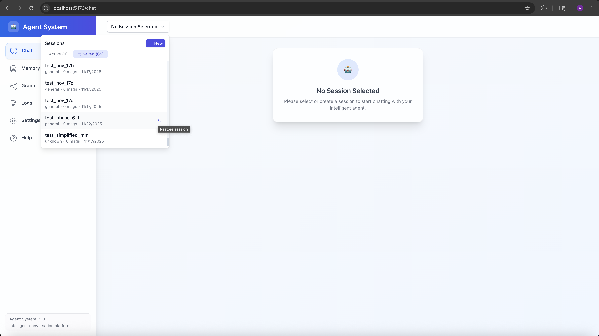
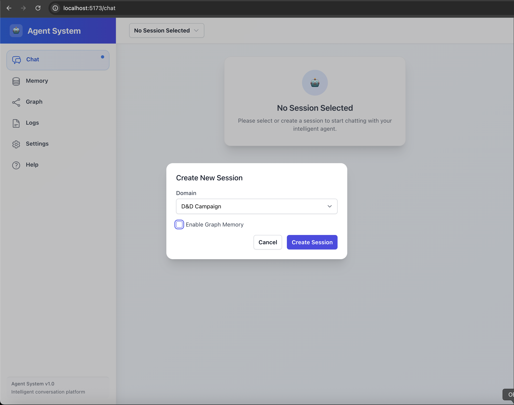
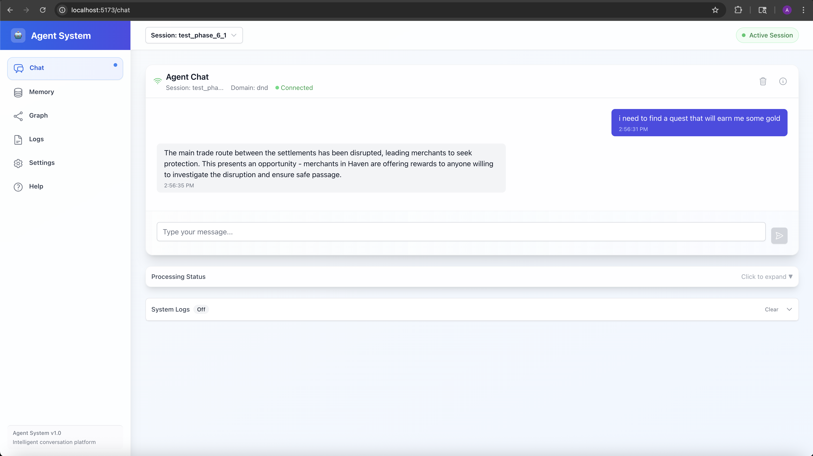
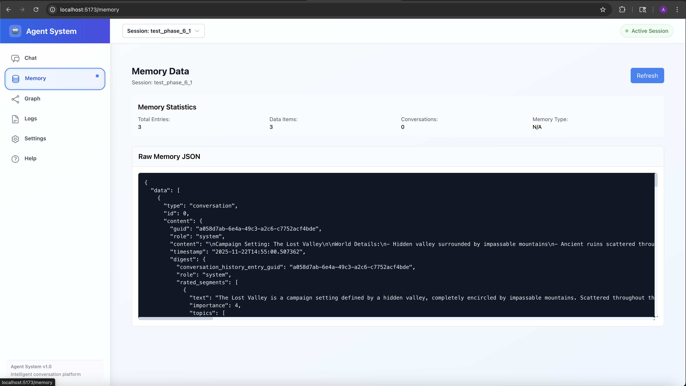
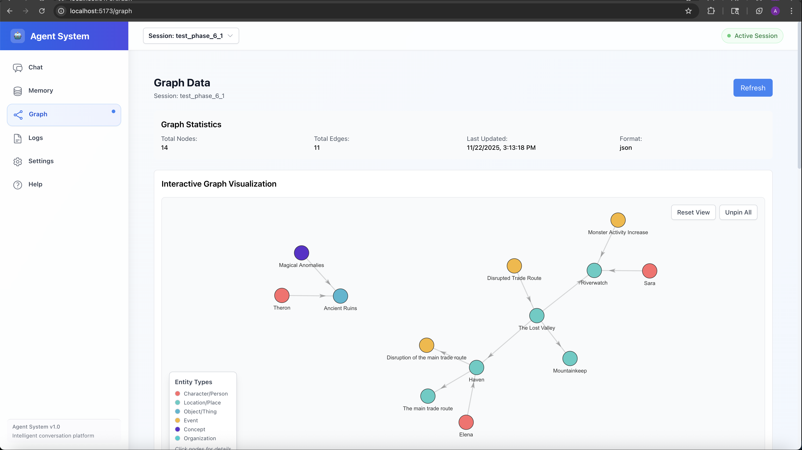
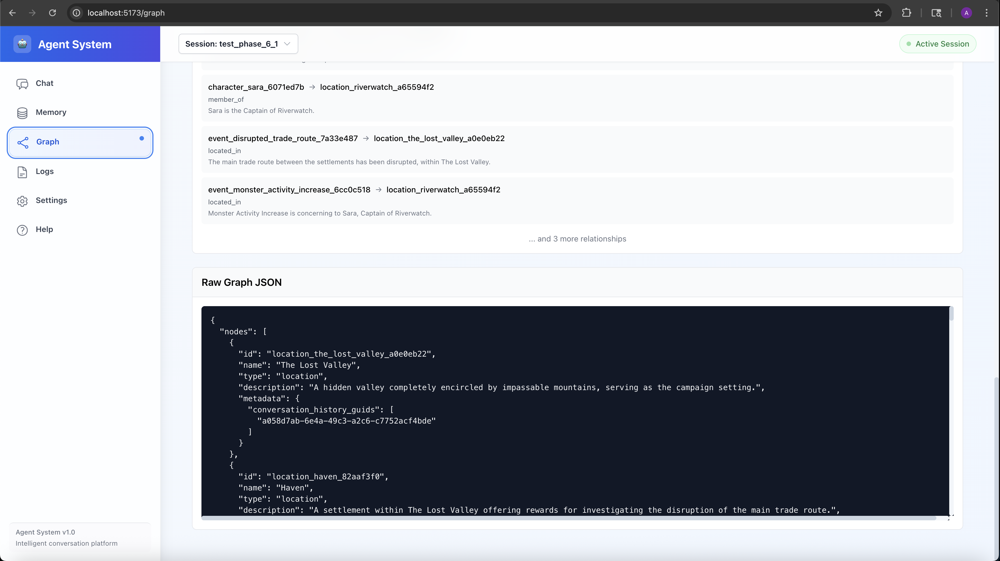
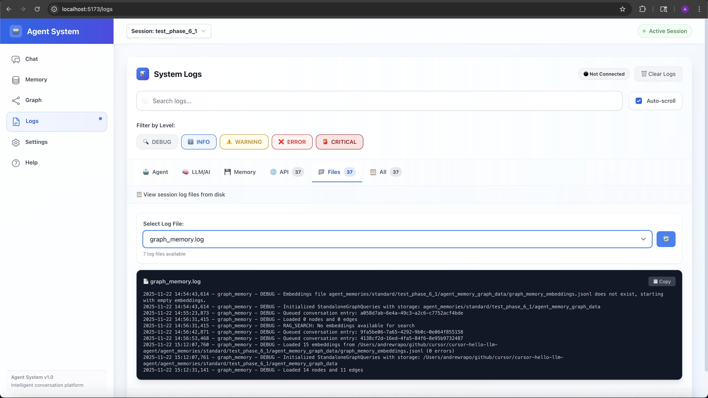

# Building an LLM Agent with Persistent Memory: A Journey in RAG, Knowledge Graphs, and Agent-Assisted Development

*How I built a domain-agnostic conversational agent with semantic memory, knowledge graphs, and a modern web interface—all while learning to code with AI assistance.*

---

## 100% Local & Private: No Cloud Required

One of the most important features of this framework is that it can run **completely offline** with zero cloud dependencies. By using local LLMs via Ollama, the entire system — from conversation processing to knowledge graph construction to semantic search — runs entirely on your machine.

This means:
- **Complete Privacy**: Your conversations, memories, and knowledge graphs never leave your device
- **No Internet Required**: Once Ollama and the models are installed, everything works offline
- **No API Costs**: No per-token charges or subscription fees—just your local compute
- **Full Control**: You own and control all data, with no external services or data sharing

The framework supports both local (Ollama) and cloud (OpenAI) providers, but the local-first design means you can build a truly private agent that works entirely disconnected from the internet. Perfect for sensitive use cases, air-gapped environments, or anyone who values data privacy.

---

## The Problem: LLMs Forget Everything

You've probably noticed that when you chat with ChatGPT or Claude, they don't remember your previous conversations unless you're in a single session. Once you close that tab, everything is gone. For complex, long-running applications—like managing a D&D campaign, tracking a research project, or building a software feature—this is a dealbreaker.

What if your AI assistant could:
- Remember every important detail from past conversations?
- Build a knowledge graph of entities and relationships over time?
- Retrieve relevant context using semantic search?
- Compress and organize memories intelligently?

That's exactly what I set out to build.

---

## What I Built

I created an **LLM-driven agent framework** with persistent, semantically searchable memory. The system uses Retrieval Augmented Generation (RAG) to find relevant context from any point in conversation history, automatically builds knowledge graphs of entities and relationships, and intelligently compresses memories to keep things manageable.

The project supports both local LLMs (via Ollama) and cloud providers (OpenAI), includes a modern React web interface, and provides a full REST and WebSocket API for integration.

**A Learning-First Design**: All key components are implemented in straightforward, bespoke Python—no complex frameworks or black-box libraries hiding the implementation details. This makes the codebase an excellent **petri dish for learning** about LLM agents, RAG systems, knowledge graphs, semantic search, and memory management. You can read the code, understand how each piece works, and experiment with modifications. Whether you're a student, researcher, or developer looking to understand these concepts deeply, this framework provides a clear, accessible implementation to study and extend.

### Key Features

**🧠 RAG-Enabled Memory**
- Conversation history is segmented and embedded at the segment level
- Semantic search retrieves relevant context for any query
- Only the most important segments are embedded (rated by the LLM itself)
- Context is automatically injected into prompts for grounded responses

**📊 Knowledge Graph Construction**
- Automatic extraction of entities (characters, locations, objects, events, concepts)
- Relationship discovery (spatial, ownership, social, causal, temporal)
- RAG-based entity resolution prevents duplicates
- Background processing keeps graph updates non-blocking

**🗜️ Intelligent Memory Compression**
- Turn-based compression after configurable intervals
- LLM rates segment importance, topics, and types
- Preserves dialogue flow while keeping memory size manageable
- Full conversation history remains traceable with GUIDs

**🌐 Modern Web Interface**
- Real-time chat with WebSocket integration
- Interactive knowledge graph visualization
- Memory and conversation history viewers
- Live log monitoring
- Session management

**🔌 Production-Ready API**
- REST endpoints for all core functionality
- WebSocket support for real-time communication
- Multi-session management
- Domain-agnostic configuration system

---

## The Architecture

The system is built with a clean separation of concerns:

### Memory Management Layer
The `MemoryManager` handles three types of memory:
- **Static Memory**: Foundational, read-only knowledge (seeded at initialization)
- **Context**: Compressed, topic-organized, high-importance information
- **Conversation History**: Full record with LLM-rated segments

### Embeddings & RAG Layer
- **EmbeddingsManager**: Generates and stores segment-level embeddings
- **RAGManager**: Retrieves semantically relevant context and injects it into prompts

### Graph Memory System
- **GraphManager**: Manages knowledge graph construction and queries
- **EntityExtractor**: LLM-driven extraction of domain-specific entities
- **RelationshipExtractor**: Discovers relationships between entities
- **EntityResolver**: Prevents duplicates using semantic similarity

### Agent Layer
- Phase-driven conversation flow (INITIALIZATION, LEARNING, INTERACTION)
- Domain-agnostic and stateless regarding memory
- Behavior controlled via external configuration files

### Background Processing
The graph processing system runs as a standalone process, allowing non-blocking knowledge graph updates while the agent continues handling queries.

---

## A Unique Development Journey

This project was "vibe-coded" using Cursor as a way to get familiar with agent-assisted development. All agent interactions have been preserved in markdown transcripts, creating a fascinating record of the development process.

The project evolved through six phases:
- **Phase 1-2**: Core memory and RAG system
- **Phase 3-4**: Knowledge graph integration
- **Phase 5**: Graph optimization and entity resolution
- **Phase 6**: API service, web UI, and background processing

Each phase built on the previous, with careful attention to modularity and testability. The result is a system where every component can be independently tested, extended, or replaced.

---

## Real-World Use Cases

### D&D Campaign Management
Create and manage a virtual campaign world with persistent memory of NPCs, locations, quests, and relationships. The knowledge graph automatically tracks connections between characters and locations, making it easy to retrieve context like "What did the innkeeper in Riverwood say about the missing merchant?"

### Research Documentation
Track laboratory work and experiments with semantic search. Ask "What were the results of the protein synthesis experiment?" and the system retrieves relevant context from any point in the conversation history.

### Software Requirements Gathering
Assist in requirements gathering and feature planning. The system remembers past discussions, tracks relationships between features, and helps maintain consistency across long-running projects.

---

## Technical Highlights

### Segment-Level Embeddings
Instead of embedding entire conversation entries, the system embeds only the most important segments (as rated by the LLM). This improves retrieval quality and efficiency.

### Turn-Based Compression
After a configurable number of turns, memory is compressed to retain only important segments while preserving dialogue flow. The full history remains available for traceability.

### Provider-Agnostic LLM Service
The system supports both local (Ollama) and cloud (OpenAI) LLMs with per-call options for temperature, streaming, and embedding models.

### Comprehensive Test Suite
The project includes extensive tests for memory, agent, embeddings, RAG, and graph memory, including automated testing with LLM-driven user simulators.

---

## Getting Started

The system is designed to be easy to set up and use:

```bash
# Install dependencies
python3 -m venv .venv
source .venv/bin/activate
pip install -e .
pip install -r requirements.txt

# Set environment variables
export OLLAMA_BASE_URL="http://localhost:11434"
export OLLAMA_MODEL="gemma3"
export OLLAMA_EMBED_MODEL="mxbai-embed-large"

# Run the canonical RAG example
python examples/rag_enhanced_memory_example_simple.py
```

Or start the web interface:

```bash
# Start the API server
python -m uvicorn src.api.main:app --host 0.0.0.0 --port 8000

# Start the web UI (in another terminal)
cd agent-web-ui
npm install
npm run dev
```

Then open `http://localhost:5173/` in your browser.


**Web UI Capabilities**:
- **Session Creation**: Start new agent sessions with configurable domain settings
- **Chat Interface**: Real-time conversation with typing indicators and streaming responses
- **Memory Tab**: View structured memory data, conversation history, and memory statistics
- **Graph Tab**: Visualize knowledge graphs with interactive node exploration
- **Log Viewer**: Monitor detailed agent logs and debugging information in real time


*Web UI - Load Session*


*Web UI - Create New Session: Start a new agent session with configurable settings.*


*Web UI - Chat Interface: Interact with the agent in real time.*


*Web UI - Session Memory Data: View the agent's persistent memory and context.*


*Web UI - Graph Memory Overview: Visualize the full graph structure of memory nodes and their relationships.*


*Web UI - Graph Memory Data Details: Inspect raw graph node and edge data.*


*Web UI - Log Viewer: Monitor detailed agent logs and debugging information in real time.*


---

## What I Learned

Building this project taught me several important lessons:

1. **Modularity Matters**: By keeping components decoupled (memory, embeddings, RAG, graph, agent), I could test and iterate on each independently.

2. **LLMs as Evaluators**: Using the LLM to rate segment importance and classify content creates a self-improving system where quality improves with use.

3. **Background Processing is Essential**: Graph construction is slow, but by moving it to a separate process, the agent remains responsive.

4. **Semantic Search > Keyword Search**: RAG-based retrieval finds relevant context even when exact keywords don't match.

5. **Agent-Assisted Development Was Effective**: Leveraging Cursor for agent-assisted development ("vibe-coding") was highly productive overall, provided I maintained careful oversight to ensure code quality. While there were occasional moments that required manual intervention or some backtracking, the majority of coding and testing was successfully handled by the agents.

---

## The Future

The system is production-ready and extensible. Future improvements could include:
- MCP (Model Context Protocol) integration
- Speech-to-text and text-to-speech support
- Improved logging and diagnostics
- Enhanced graph visualization
- Multi-modal memory (images, audio, etc.)

---

## Open Source & Available

The project is open source and available on GitHub. It's a complete, working system that demonstrates modern LLM agent architecture with persistent memory, RAG, and knowledge graphs.

Whether you're building a similar system, learning about RAG and knowledge graphs, or just curious about agent-assisted development, I hope this project provides value and inspiration.

---

## Key Takeaways

- **Persistent memory** makes LLM agents truly useful for long-running applications
- **RAG** enables semantic search over conversation history
- **Knowledge graphs** provide structured understanding of relationships
- **Modular architecture** makes complex systems manageable
- **Agent-assisted development** can be highly productive with proper oversight

If you're interested in building LLM agents with memory, or just want to see how RAG and knowledge graphs work in practice, check out the project. The code is well-documented, the examples are clear, and the test suite is comprehensive.

Happy coding! 🚀

---

*For more details, architecture diagrams, and development history, see the project README and phase documentation.*

